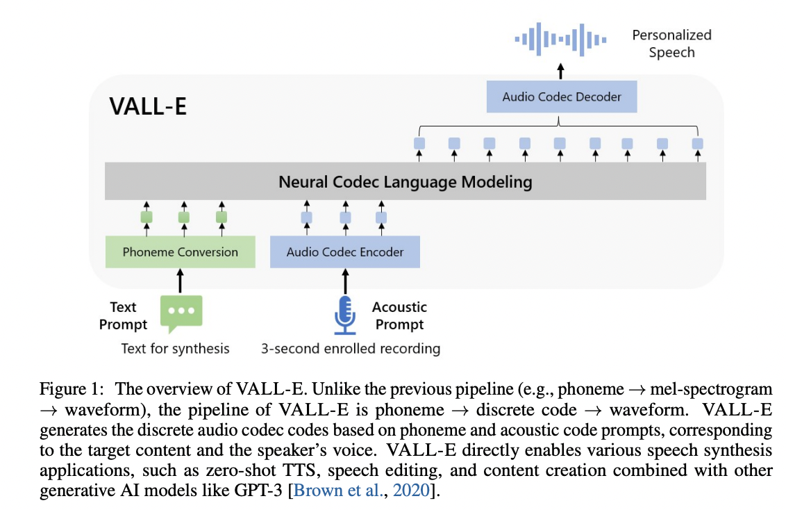

<p align="center">
</img>
</p>

# VALL'E

Zero-shot text-to-speech at 44.1 kHz: give it text and a few seconds of someone's voice, and it speaks the text in that
voice. Multilingual (English, French, German, Japanese, Chinese, Korean).

This is the third design of the project ("v3"). Audio is [NVIDIA's 44.1 kHz FSQ codec](https://huggingface.co/nvidia/audio-codec-44khz),
read and generated as continuous values rather than tokens: a transformer over `[text][voice prompt][target]` and a
flow-matching head that generates each position's audio values jointly, filling the target in by masked generation
(`docs/model.md`). The EnCodec models and the earlier architectures are in the `v2-final` tag.

## Results

On a frozen 237-item evaluation set of unseen speakers (`docs/eval.md`):

| | WER / CER | Speaker similarity |
|---|---|---|
| real recordings (the ceiling) | 7.3% | 0.717 |
| **v3** | **7.4%** | **0.722** |

English: 3.9% WER, similarity 0.686. 225M parameters, trained on ~16k hours (`docs/train.md`).

## Requirements

A PyTorch environment, and [`espeak-ng`](https://github.com/espeak-ng/espeak-ng/) for phonemizing text (Linux: your
package manager; Windows: the installer, and possibly `PHONEMIZER_ESPEAK_LIBRARY` pointing at `libespeak-ng.dll`).

```
pip install -e .            # [ja] for Japanese text, [eval] for number expansion when scoring
```

## Use

```
python -m vall_e.tts --ckpt <checkpoint> --text "Hello there." --prompt voice.wav --out out.wav
```

```python
from vall_e.tts import TTS
tts = TTS("<checkpoint>")
wav = tts.generate("Hello there.", prompt="voice.wav", language="en")   # [1, samples] at 44.1 kHz
```

Or a web page (`pip install -e .[webui]`):

```
python -m vall_e.webui --ckpt <checkpoint> [--models training] [--listen 0.0.0.0] [--share]
```

The length is predicted unless `--duration` is given; long texts are generated sentence by sentence; `--prompt` can be
left out for an unconditioned voice. Defaults: 25 steps, guidance 6.0, speaker guidance 2.0.

## Layout

| | |
|---|---|
| `vall_e/model.py` | the model, the flow head, masked and AR generation |
| `vall_e/tts.py`, `vall_e/webui.py` | inference: text + prompt -> audio, and its web page |
| `vall_e/train.py`, `vall_e/data.py` | training, batching |
| `vall_e/store.py`, `vall_e/noisy.py` | the data store, and baked noisy prompts (`docs/data.md`) |
| `vall_e/evalset.py` | the evaluation set: WER / CER, speaker similarity, paired comparisons |
| `vall_e/fsq.py`, `vall_e/emb/` | the codec's quantizer, the codec, phonemizer, ASR and speaker models |
| `scripts/` | `recipe.sh` (how the model was trained), `train.sh`, `evaluate.sh`, `textuse-gate.sh` |
