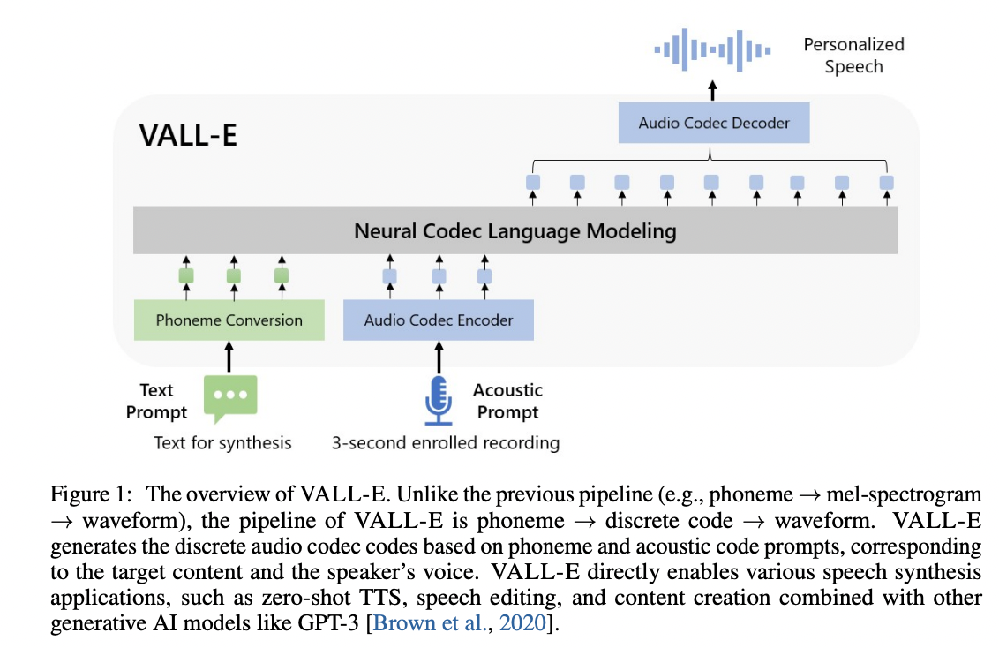

<p align="center">
</img>
</p>

# VALL'E

Zero-shot text-to-speech at 44.1 kHz: give it text and a few seconds of someone's voice, and it speaks the text in that
voice. Multilingual (English, French, German, Japanese, Chinese, Korean).

Audio is [NVIDIA's 44.1 kHz FSQ codec](https://huggingface.co/nvidia/audio-codec-44khz), read and generated as continuous values rather than tokens: a transformer over `[text][voice prompt][target]` and a flow-matching head that generates each position's audio values jointly, filling the target in by masked generation (`docs/model.md`).

This is the third design of the project ("v3") with *heavy* LLM assistance to identify pitfalls from my notes of the previous iterations, without consideration of maintaining interop with prior versions.

Code and documentation for the EnCodec models and the earlier architectures are in the [`v2-final`](https://github.com/e-c-k-e-r/vall-e/tree/v2-final) tag.

## Results

On a frozen 237-item evaluation set of unseen speakers in six languages (`docs/eval.md`):

| | WER / CER | Speaker similarity | UTMOS |
|---|---|---|---|
| real recordings (the ceiling) | 7.3% | 0.717 | 3.14 |
| **v2.0** (746M) | **7.1%** | **0.744** | **3.42** |
| v2.0-fast (746M, distilled) | 7.2% | 0.733 | 3.50 |
| v1.3 (225M) | 6.0% | 0.739 | 3.27 |

English: v2.0 5.1% WER, similarity 0.709. On held-out game, Genshin and Nikke characters v2.0 has the highest
similarity of the three (0.611 / 0.689 / 0.538 against v1.3's 0.587 / 0.675 / 0.513). Trained on ~16.7k hours plus
voiced game dialogue (`docs/train.md`).

## Requirements

A PyTorch environment, and [`espeak-ng`](https://github.com/espeak-ng/espeak-ng/) for phonemizing text (Linux: your
package manager; Windows: the installer, and possibly `PHONEMIZER_ESPEAK_LIBRARY` pointing at `libespeak-ng.dll`).

```
pip install -e .            # [ja] for Japanese text, [eval] for number expansion when scoring
```

## Use

```
python -m vall_e.tts --text "Hello there." --prompt voice.wav --out out.wav
```

```python
from vall_e.tts import TTS
tts = TTS()   # the default model (v2.0), downloaded to data/models/ on first use; or TTS("<released name, checkpoint or export>")
wav = tts.generate("Hello there.", prompt="voice.wav", language="en")   # [1, samples] at 44.1 kHz
```

Or a web page (`pip install -e .[webui]`):

```
python -m vall_e.webui [--ckpt <checkpoint or export>] [--models training] [--listen 0.0.0.0] [--share]
```

`TTS` also has `continue_speech(audio, said, new)` (generate what follows a recording) and `edit(audio, text, start, end)`
(re-speak a stretch of it).

The length is predicted unless `--duration` is given; long texts are generated sentence by sentence; `--prompt` can be
left out for an unconditioned voice. Defaults: 25 steps, and the guidance the model was tuned for.

## Models

The released models ([`models/ckpt/nemo-44khz`](https://huggingface.co/ecker/vall-e/tree/main/models/ckpt/nemo-44khz)) download on first use when
named (`--ckpt nemo-44khz-nar-flow-746m-v2.0-fast.sft`, `TTS("nemo-44khz-nar-flow-225m-v1.3.sft")`):

| File | | Guidance (text / speaker) | Speed (RX 7900 XTX) |
|---|---|---|---|
| `nemo-44khz-nar-flow-746m-v2.0.sft` | 746M, the default | 3.0 / 2.0 | 2.6x real time |
| `nemo-44khz-nar-flow-746m-v2.0-fast.sft` | v2.0 guidance-distilled: one pass per step | none | 4.8x |
| `nemo-44khz-nar-flow-225m-v1.3.sft` | 225M | 6.0 / 2.0 | 5.3x |
| `nemo-44khz-codec.sft` | the codec, exported for engines (volta-engine) | | |

## Layout

| | |
|---|---|
| `vall_e/model.py` | the model, the flow head, masked and AR generation |
| `vall_e/tts.py`, `vall_e/webui.py` | inference: text + prompt -> audio, and its web page |
| `vall_e/train.py`, `vall_e/data.py` | training, batching |
| `vall_e/store.py`, `vall_e/noisy.py` | the data store, and baked noisy prompts (`docs/data.md`) |
| `vall_e/evalset.py` | the evaluation set: WER / CER, speaker similarity, paired comparisons |
| `vall_e/fsq.py`, `vall_e/emb/` | the codec's quantizer, the codec, phonemizer, ASR and speaker models |
| `vall_e/export.py` | release exports (fp16 safetensors, config in the metadata) and the default model download |
| `scripts/` | `recipe.sh` (how the model was trained), `train.sh`, `evaluate.sh`, `textuse-gate.sh` |
